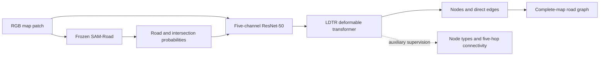

# TRASA

[](https://github.com/knowledge-computing/TRASA/actions/workflows/tests.yml)
[](https://www.python.org/downloads/)
[](https://pytorch.org/get-started/previous-versions/)

**Topology-Preserving Road Network Extraction from Historical Topographic Maps**

TRASA extracts road graphs from RGB topographic maps. This repository accompanies the SIGSPATIAL 2026 manuscript and includes data preparation, fold-specific geometry training, graph training, complete-map inference, evaluation, and generation of result tables.

[Installation](#installation) · [Quick start](#quick-start) · [Dataset](#dataset) · [Training](#training) · [Inference](#inference) · [Baselines](#baselines) · [Reproduction guide](REPRODUCING.md) · [Upstream code](third_party/README.md)

## Architecture



The graph model uses an ImageNet-pretrained ResNet-50, four feature levels, 100 node queries and one relation token, three encoder/decoder layers, eight attention heads, and hidden dimension 256. The additional input filters are initialized from the mean RGB filter. Node-type classification distinguishes no-node, endpoint, intermediate, and intersection; five-hop connectivity provides an auxiliary training objective. Graph decoding uses node validity and direct-edge probabilities, each with threshold 0.5.

Complete pinned **LDTR, SAM-Road, and SAM sources are included** under [third_party/](third_party/README.md). The runtime package contains the adapted components used by TRASA, including differentiable deformable attention without a compiled CUDA extension.

## Installation

Use Python 3.10 with PyTorch 2.5.1 and torchvision 0.20.1:

```bash
git clone https://github.com/knowledge-computing/TRASA.git
cd TRASA
python3.10 -m venv .venv
source .venv/bin/activate
python -m pip install --upgrade pip
```

For the verified CPU environment, including tests, dataset building, VTP annotations, baseline conversion, and GIS export:

```bash
python -m pip install -r requirements-research.lock
python -m pip check
```

For GPU training, install CUDA wheels in a separate environment. CUDA 12.4 example:

```bash
python -m pip install torch==2.5.1 torchvision==0.20.1 --index-url https://download.pytorch.org/whl/cu124
python -m pip install -e '.[test,data,baselines,gis]'
python -c "import torch; print('CUDA available:', torch.cuda.is_available())"
```

The GPT-5.5 baseline also needs `python -m pip install -e '.[api]'` and `OPENAI_API_KEY`; SAM3 needs the facebookresearch/sam3 package and weights. Select wheels compatible with your driver using the [official PyTorch instructions](https://pytorch.org/get-started/previous-versions/). The CPU lock file installs CPU wheels. GPU execution has not been verified; CUDA grid-sampling backward can be nondeterministic.

## Quick start

Run a small offline demonstration and the test suite:

```bash
python -m trasa.demo --output runs/synthetic_demo
OMP_NUM_THREADS=2 python -m pytest -q
```

The demo prepares synthetic maps, trains and resumes the RGB+NTC variant, reconstructs a complete-map graph, evaluates it, and writes tables. It uses a smaller model and is an execution check. Synthetic outputs are labeled and do not represent benchmark accuracy.

To exercise geometry training and all four variants with real SAM initialization:

```bash
python -m trasa.demo --output runs/synthetic_guided_demo --sam-checkpoint weights/sam_vit_b_01ec64.pth --variants ldtr ldtr-sam ldtr-ntc trasa
```

## Dataset

The benchmark is rebuilt from public USGS sheets; no USGS raster is stored in this repository. [datasets/trasa_ca24/](datasets/trasa_ca24/README.md) holds everything else: the USGS URL and SHA256 of each of the 8 sheets, the corrected road annotations (the only hand-made data), the patch/graph settings, the 8 folds and the expected checksum of every built file.

```bash
python -m trasa.reproduce_dataset --spec datasets/trasa_ca24/dataset.yaml --output data/benchmark
```

This downloads the sheets into a cache outside the repo (`~/.cache/trasa` or `$TRASA_CACHE`), checks every source hash, cuts the map frames into 256×256 patches, clips the corrected road graph to each patch (road types, line widths, at most 100 nodes), writes road masks, compares every output file with the published checksums and writes `data/benchmark/folds/fold_00.json` … `fold_07.json`. The steps can also be run one by one:

| Command | Does |
|---|---|
| `trasa.usgs_lookup` | Writes spec entries (URL, year, quadrangle bounds) from the USGS metadata CSV |
| `trasa.tiger_init` | First-draft annotation for a sheet from 2021 TIGER/Line (to be corrected by hand) |
| `trasa.fetch_sources` | Downloads and SHA256-checks the sheets and annotations; `--lock` records hashes once |
| `trasa.build_dataset` | Builds patches, graphs, masks, map references, `index.json`, `checksums.json`; `--preview` draws frame and roads |
| `trasa.verify_dataset` | Compares a build with `expected_checksums.json`, grouped by images / graphs / masks |

| Other artifacts | |
|---|---|
| [SAM ViT-B initialization](https://dl.fbaipublicfiles.com/segment_anything/sam_vit_b_01ec64.pth) | Initializes geometry training |
| Fold-specific geometry and graph checkpoints | Produced by the training commands below; not bundled |

ImageNet ResNet-50 weights download through torchvision on first use. See the [dataset format](REPRODUCING.md#dataset-format) for JSON/VTP graphs, masks, provenance and coordinate conventions.

## Training

Run commands from the repository root. After `reproduce_dataset` the folds are in `data/benchmark/folds/` (for your own data, see [the reproduction guide](REPRODUCING.md#dataset-format)).

Train geometry using the first fold's training maps, select on its validation map, and cache continuous guidance:

```bash
python -m trasa.train_geometry --manifest data/benchmark/folds/fold_00.json --sam-checkpoint weights/sam_vit_b_01ec64.pth --output runs/geometry/fold_00 --device cuda
python -m trasa.cache_guidance --manifest data/benchmark/folds/fold_00.json --checkpoint runs/geometry/fold_00/best.ckpt --output data/guidance/fold_00 --device cuda
python -m trasa.train --config configs/paper.yaml --manifest data/guidance/fold_00/manifest.json --ablation trasa --output runs/trasa/fold_00 --device cuda
```

[configs/paper.yaml](configs/paper.yaml) specifies AdamW, learning rate and weight decay 1e-4, batch size 8, 100 epochs, and loss weights 1/1/1/0.5. Four variants share this configuration:

| `--ablation` | Geometry guidance | Node-type supervision |
|---|:---:|:---:|
| `ldtr` | | |
| `ldtr-sam` | ✓ | |
| `ldtr-ntc` | | ✓ |
| `trasa` | ✓ | ✓ |

Training saves validation-selected `best.pt`, resumable `last.pt`, history, configuration, dataset/checkpoint fingerprints, and execution metadata. Resume with the same command plus `--resume runs/trasa/fold_00/last.pt`. `--val-metrics-every N` computes map-level validation metrics only every N epochs (checkpoint selection always uses the validation loss). The paper uses a constant learning rate and no gradient clipping; `lr_drop_epoch`, `lr_drop_factor` and `grad_clip_norm` in the config switch them on for other experiments.

## Inference

Extract a graph from a new RGB map without reference annotations:

```bash
python -m trasa.infer --checkpoint runs/trasa/fold_00/best.pt --geometry-checkpoint runs/geometry/fold_00/best.ckpt --image dataset/new_map.png --output results/new_map_graph.json --device cuda
```

Use the geometry checkpoint that generated the graph model's training guidance. Inference tiles the image, handles boundaries and overlaps, and merges patch graphs within five pixels. JSON retains pixel coordinates and prediction attributes. For a georeferenced GeoTIFF, add `--read-georeferencing` and use a `.geojson` or `.gpkg` output. RGB-only variants omit `--geometry-checkpoint`.

## Evaluation and tables

Choose node/edge thresholds on the validation map (the paper's 0.5/0.5 is the default), then predict and evaluate the held-out complete map:

```bash
python -m trasa.select_thresholds --manifest data/guidance/fold_00/manifest.json --checkpoint runs/trasa/fold_00/best.pt --output runs/trasa/fold_00/thresholds.json --device cuda
python -m trasa.predict_dataset --manifest data/guidance/fold_00/manifest.json --checkpoint runs/trasa/fold_00/best.pt --thresholds runs/trasa/fold_00/thresholds.json --output results/trasa/fold_00 --device cuda
```

`--thresholds` is optional. Outputs include reconstructed predictions, reference graphs, and `metrics.json`. Metrics cover completeness, correctness, quality, APLS, intersections, degree accuracy, connectivity, split errors, spurious branches, four-class Type F1 for NTC variants, and completeness per road type (highway, secondary highway, light duty road, paved light duty road, trail). Definitions and empty-case conventions are in the [evaluation protocol](REPRODUCING.md#evaluation-protocol).

After preparing all eight geometry caches, run the four variants and regenerate tables:

```bash
python -m trasa.benchmark --fold-manifests data/guidance/fold_*/manifest.json --config configs/paper.yaml --output runs/benchmark --device cuda
python -m trasa.tables --reports runs/benchmark/*/fold_*/test/metrics.json --output results/tables
```

Add `--dry-run` to the benchmark command to inspect its planned runs. Tables (`main_results`, `ablations`, `road_types`) are calculated from experiment artifacts and include means, population standard deviations, and provenance.

## Baselines

| Baseline | How it runs here |
|---|---|
| LDTR | `--ablation ldtr` (same backbone and settings as TRASA) |
| GPT-5.5 | `python -m trasa.run_gpt --manifest <fold> --example <train/val patch id> --output <dir>`: paper prompt per road type, one fixed example, temperature 0, top-p 1, 4096 tokens, JSON schema; every answer is saved |
| SAM3 | `python -m trasa.run_sam3 --manifest <fold> --output <dir>`: text prompt "[road type] roads" per type, masks merged by instance score |
| SAM-Road, Sat2Graph | `python -m trasa.export_baselines cityscale ...` writes their native region format; `export_baselines import-cityscale` reads their graph pickles back |
| RelationFormer | `python -m trasa.export_baselines vtp ...` writes their native patch format; `export_baselines import-vtp` reads predictions back |

All baselines are scored with `trasa.baseline_evaluate` on the same held-out maps and graph conversion (threshold 0.5, components ≥ 20 px, spurs ≥ 8 px). Details: [external baselines](REPRODUCING.md#external-baselines). `python -m trasa.figures` draws the qualitative comparison (paper Fig. 3) from the saved map graphs.

## Reproducibility status

CPU execution, checkpoint resume, all four variants, geometry training, map reconstruction, evaluation, the dataset build (on synthetic georeferenced sheets) and the baseline runners (with stand-in model clients) are covered by tests. Published numerical results have not been reproduced. Open items: the 8 sheet entries, corrected annotations, fold schedule and expected checksums in `datasets/trasa_ca24/`; one GPU run of all methods with this code; and a check of the unspecified settings listed in the [reproduction guide](REPRODUCING.md#implementation-conventions).

The implemented APLS protocol is explicitly named `control_point_apls_v1`, a pixel-space approximation. Geometry-label semantics and other implementation choices are recorded in the [reproduction guide](REPRODUCING.md#implementation-conventions) and experiment metadata.

For all command options, run `python -m trasa.<command> --help`. Source revisions, checksums, and license notices are listed in [third_party/README.md](third_party/README.md).

## Citation

See [CITATION.cff](CITATION.cff) (SIGSPATIAL '26, DOI [10.1145/3841645.3843303](https://doi.org/10.1145/3841645.3843303)).
