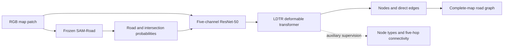

# TRASA

[](https://github.com/knowledge-computing/TRASA/actions/workflows/tests.yml)
[](https://www.python.org/downloads/)
[](https://pytorch.org/get-started/previous-versions/)

**Topology-Preserving Road Network Extraction from Historical Topographic Maps**

TRASA extracts road graphs from RGB topographic maps. This repository accompanies the SIGSPATIAL 2026 manuscript and includes data preparation, fold-specific geometry training, graph training, complete-map inference, evaluation, and generation of result tables.

[Installation](#installation) · [Quick start](#quick-start) · [Training](#training) · [Inference](#inference) · [Reproduction guide](REPRODUCING.md) · [Upstream code](third_party/README.md)

## Architecture



The graph model uses an ImageNet-pretrained ResNet-50, four feature levels, 100 node queries and one relation token, three encoder/decoder layers, eight attention heads, and hidden dimension 256. The additional input filters are initialized from the mean RGB filter. Node-type classification distinguishes no-node, endpoint, intermediate, and intersection; five-hop connectivity provides an auxiliary training objective. Graph decoding uses node validity and direct-edge probabilities, each with threshold 0.5.

Complete pinned **LDTR, SAM-Road, and SAM sources are included** under [third_party/](third_party/README.md). The runtime package contains the adapted components used by TRASA, including differentiable deformable attention without a compiled CUDA extension.

## Installation

Use Python 3.10 with PyTorch 2.5.1 and torchvision 0.20.1:

```bash
git clone https://github.com/knowledge-computing/TRASA.git
cd TRASA
python3.10 -m venv .venv
source .venv/bin/activate
python -m pip install --upgrade pip
```

For the verified CPU environment, including tests, VTP annotations, baseline conversion, and GIS export:

```bash
python -m pip install -r requirements-research.lock
python -m pip check
```

For GPU training, install CUDA wheels in a separate environment. CUDA 12.4 example:

```bash
python -m pip install torch==2.5.1 torchvision==0.20.1 --index-url https://download.pytorch.org/whl/cu124
python -m pip install -e '.[test,data,baselines,gis]'
python -c "import torch; print('CUDA available:', torch.cuda.is_available())"
```

Select wheels compatible with your driver using the [official PyTorch instructions](https://pytorch.org/get-started/previous-versions/). The CPU lock file installs CPU wheels. GPU execution has not been verified; CUDA grid-sampling backward can be nondeterministic.

## Quick start

Run a small offline demonstration and the test suite:

```bash
python -m trasa.demo --output runs/synthetic_demo
OMP_NUM_THREADS=2 python -m pytest -q
```

The demo prepares synthetic maps, trains and resumes the RGB+NTC variant, reconstructs a complete-map graph, evaluates it, and writes tables. It uses a smaller model and is an execution check. Synthetic outputs are labeled and do not represent benchmark accuracy.

To exercise geometry training and all four variants with real SAM initialization:

```bash
python -m trasa.demo --output runs/synthetic_guided_demo --sam-checkpoint weights/sam_vit_b_01ec64.pth --variants ldtr ldtr-sam ldtr-ntc trasa
```

## Data and checkpoints

| Required artifact | Purpose |
|---|---|
| Eight annotated maps, RGB 256×256 patches, corrected graphs, and patch origins | Historical-map benchmark |
| Original map-level fold schedule | Six training maps, one validation map, and one test map per fold |
| Corrected road masks or road-dependent label widths | Geometry supervision |
| [SAM ViT-B initialization](https://dl.fbaipublicfiles.com/segment_anything/sam_vit_b_01ec64.pth) | Initialize geometry training |
| Fold-specific geometry and graph checkpoints | Produced by the training commands below |

The corrected benchmark, original fold assignments, and trained study weights are not bundled. ImageNet ResNet-50 weights download through torchvision on first use. Vanilla SAM weights initialize the encoder; a road decoder must be trained before generating guidance. See the [dataset format](REPRODUCING.md#dataset-format) for JSON/VTP graphs, masks, provenance, and coordinate conventions.

## Training

Run commands from the repository root. Prepare your sample index and exact fold schedule as described in the [reproduction guide](REPRODUCING.md):

```bash
python -m trasa.prepare_data --index dataset/index.json --coordinates pixels --copy-images --output data/prepared
python -m trasa.validate_data --manifest data/prepared/manifest.json --without-guidance --paper --output results/data_validation.json
python -m trasa.folds --manifest data/prepared/manifest.json --schedule dataset/fold_schedule.json --output data/folds
```

Train geometry using the first fold's training maps, select on its validation map, and cache continuous guidance:

```bash
python -m trasa.train_geometry --manifest data/folds/fold_00.json --sam-checkpoint weights/sam_vit_b_01ec64.pth --output runs/geometry/fold_00 --device cuda
python -m trasa.cache_guidance --manifest data/folds/fold_00.json --checkpoint runs/geometry/fold_00/best.ckpt --output data/guidance/fold_00 --device cuda
python -m trasa.train --config configs/paper.yaml --manifest data/guidance/fold_00/manifest.json --ablation trasa --output runs/trasa/fold_00 --device cuda
```

[configs/paper.yaml](configs/paper.yaml) specifies AdamW, learning rate and weight decay 1e-4, batch size 8, 100 epochs, and loss weights 1/1/1/0.5. Four variants share this configuration:

| `--ablation` | Geometry guidance | Node-type supervision |
|---|:---:|:---:|
| `ldtr` | | |
| `ldtr-sam` | ✓ | |
| `ldtr-ntc` | | ✓ |
| `trasa` | ✓ | ✓ |

Training saves validation-selected `best.pt`, resumable `last.pt`, history, configuration, dataset/checkpoint fingerprints, and execution metadata. Resume with the same command plus `--resume runs/trasa/fold_00/last.pt`.

## Inference

Extract a graph from a new RGB map without reference annotations:

```bash
python -m trasa.infer --checkpoint runs/trasa/fold_00/best.pt --geometry-checkpoint runs/geometry/fold_00/best.ckpt --image dataset/new_map.png --output results/new_map_graph.json --device cuda
```

Use the geometry checkpoint that generated the graph model's training guidance. Inference tiles the image, handles boundaries and overlaps, and merges patch graphs within five pixels. JSON retains pixel coordinates and prediction attributes. For a georeferenced GeoTIFF, add `--read-georeferencing` and use a `.geojson` or `.gpkg` output. RGB-only variants omit `--geometry-checkpoint`.

## Evaluation and tables

Predict and evaluate a held-out complete map:

```bash
python -m trasa.predict_dataset --manifest data/guidance/fold_00/manifest.json --checkpoint runs/trasa/fold_00/best.pt --output results/trasa/fold_00 --device cuda
```

Outputs include reconstructed predictions, reference graphs, and `metrics.json`. Metrics cover completeness, correctness, quality, APLS, intersections, degree accuracy, connectivity, split errors, spurious branches, and four-class Type F1 for NTC variants. Definitions and empty-case conventions are in the [evaluation protocol](REPRODUCING.md#evaluation-protocol).

After preparing all eight geometry caches, run the four variants and regenerate tables:

```bash
python -m trasa.benchmark --fold-manifests data/guidance/fold_*/manifest.json --config configs/paper.yaml --output runs/benchmark --device cuda
python -m trasa.tables --reports runs/benchmark/*/fold_*/test/metrics.json --output results/tables
```

Add `--dry-run` to the benchmark command to inspect its planned runs. Tables are calculated from experiment artifacts and include means, population standard deviations, and provenance. The guide also covers [external prediction adapters](REPRODUCING.md#external-baselines).

## Reproducibility status

CPU execution, checkpoint resume, all four variants, geometry training, map reconstruction, and evaluation have been tested using synthetic inputs and real SAM initialization. Published numerical results have not been reproduced. Exact reproduction requires the corrected benchmark, original folds, study checkpoints/evaluator, and verification of unspecified methodological settings.

The implemented APLS protocol is explicitly named `control_point_apls_v1`, a pixel-space approximation. Geometry-label semantics and other implementation choices are recorded in the [reproduction guide](REPRODUCING.md#implementation-conventions) and experiment metadata.

For all command options, run `python -m trasa.<command> --help`. Source revisions, checksums, and license notices are listed in [third_party/README.md](third_party/README.md).
